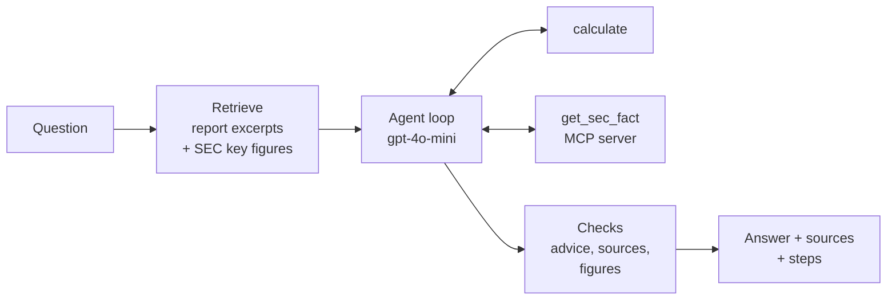

# Financial Report Analyst

An AI agent that answers questions about public companies from their SEC 10-K annual reports. Every number in an answer cites the page or data source it came from.

Ask *"What is PepsiCo's FY2022 EBITDA margin?"* and the agent finds the income statement and cash flow pages, calculates (11,512 + 2,763) / 86,392 with a calculator tool, and answers **16.52%**, listing its sources and the steps it took.


## Demo

<!-- screenshot of the UI goes here -->

The app runs on Render: a FastAPI service (`POST /ask`) and a Streamlit UI that calls it. Questions to try:

| Question | What it shows |
|---|---|
| What was AMD's net revenue in FY2022? | A lookup: one model call, the figure cited to the income statement page |
| What is PepsiCo's FY2022 EBITDA margin? | A calculation: inputs from the report and SEC figures, result from the calculator tool |
| What was Boeing's R&D expense in FY2019? | A year that isn't in the report's PDF, fetched from the SEC through the MCP server |
| What was Orange's net revenue in FY2020? | A company that isn't in the corpus: the agent says so instead of guessing |
| Should I buy Apple stock? | Investment advice: politely declined |

Each answer shows a confidence badge, a receipt (cost · model calls · calculations · seconds), the figures with their sources, and a "How I got this answer" panel. A typical question costs $0.001–0.003.

## What it does

- **Answers from 12 real 10-Ks**: AMD, American Express, Boeing, PepsiCo, 3M, AES, CVS Health, Johnson & Johnson, Verizon (FY2022), Amcor, Best Buy (FY2023) and Apple (FY2025).
- **Cites its sources**: each figure links to a report page or to SEC XBRL data, shown in a sources table.
- **Calculates with a tool**: ratios and growth rates are computed by a calculator, not in the model's head.
- **Looks up SEC data** for other years through an MCP server.
- **Shows its work**: a "How I got this answer" panel lists every retrieval, tool call and check.
- **Remembers past analyses** per user name, but only answers that passed every check.
- **Has guardrails**: it declines investment advice, rejects calculations that use numbers not found in the sources, and marks answers with unverified figures as low confidence.

## How it works



1. **Retrieval (RAG).** The 10-Ks are split into page-level chunks, embedded with `text-embedding-3-small` and stored in Qdrant. A question gets its 11 most similar chunks plus 3 chunks each from the balance sheet, income statement and cash flow statement of the company it is about, plus a small table of SEC XBRL key figures for that report.
2. **Agent loop.** `gpt-4o-mini` (OpenAI Responses API) reads the excerpts and may call tools for up to 4 rounds:
   - `calculate`: safe arithmetic (parsed with Python's `ast`, no `eval`).
   - `get_sec_fact`: a live SEC companyfacts lookup, served by a small MCP server (`fastmcp`).
3. **Structured, checked output.** The answer is a Pydantic model (answer, figures with sources, confidence). Code then checks that every figure appears in its cited source or matches a calculator result, that numbers in the answer text are backed by a figure, and that no calculation filled a missing input with 0; any warning sets confidence to low. Advice requests get a fixed decline.

## Results

Evaluated on 48 questions from [FinanceBench](https://github.com/patronus-ai/financebench) that cover the 11 FinanceBench reports in the corpus, each with a reference answer and evidence pages.

| Version | Correct |
|---|---|
| Naive RAG (top 5 chunks) | 9/48 |
| Tuned RAG (prompt, top 20 chunks), shipped in Unit 2 | 17/48 |
| Agent (statement retrieval, SEC figures, calculator, MCP), labelled by hand | 32/48 (67%) |
| **Agent + fixes from the failure analysis, checked by hand** | **34/48 (71%)** |

For context, the FinanceBench paper reports GPT-4-Turbo with a shared vector store failing or refusing about 81% of its questions.

**Can the automatic judge be trusted?** An LLM judge (`gpt-4o-mini`) grades every eval run. I labelled all 48 answers by hand and compared:

| Judge | Agrees with hand labels | Accepts correct answers (TPR) | Rejects wrong answers (TNR) |
|---|---|---|---|
| Original | 36/48 | 62.5% | 100% |
| After one prompt fix | 42/48 | 84.4% | 93.8% |

The original judge was too strict, mostly on short but correct answers. The fix was tuned on these same 48 answers, so the "after" numbers are somewhat optimistic.

**Fixing what the failure analysis found.** The first hand-labelled run had 16 wrong answers. The fixes were general rules, not patches for single questions: the SEC lookup matches any figure name to the closest XBRL label (and refuses weak matches rather than return a wrong number), the agent stops when it only repeats earlier tool calls, wrong citations are moved to the excerpt that holds the number, and two new checks lower confidence when a number in the answer text has no source or a calculation uses 0 as an input. Three targeted questions became correct (AMD and Verizon quick ratio, Amcor gross margin), one became wrong (AES return on assets: the sign of a net loss was dropped). A change of 2 is within run-to-run noise, but every changed verdict was checked by hand.

**Why the agent is still wrong (14 answers):**

| Cause | Count |
|---|---|
| The page with the key fact wasn't retrieved | 5 |
| Misread the question, scope or metric | 4 |
| Right numbers, wrong conclusion | 3 |
| Sign of a net loss dropped | 1 |
| PDF table extraction | 1 |

In 9 of the 14 wrong answers the right page *was* retrieved: most failures happen in reasoning, not retrieval. Every experiment, with its setup and score, is logged in [`results/rag_experiments.md`](results/rag_experiments.md).

## Memory

Enter a name in the sidebar and the agent keeps an **episodic memory**: a record of your earlier analyses, stored in a separate Qdrant collection (`memories`) and filtered by name.

- **Recall.** A new question is embedded and compared with your past questions. Up to 3 with a cosine similarity of at least 0.45 are shown under "From your earlier analyses" and passed to the model as background.
- **Not a source.** Recalled analyses get no excerpt number, so the model can't cite them or take numbers from them. Every figure still has to come from the reports or the SEC data.
- **Write gate.** An answer is saved (question, short answer, key figures, date) only if it has sources, no warnings, isn't low confidence and isn't an advice request. A wrong answer would otherwise be recalled and repeated later. The UI says whether each answer was saved.
- **No name, no memory.** Evals run without a name, so memory never affects the scores.

Memory lives in `app/memory.py`. Names are lower-cased and trimmed, so "Ana " and "ana" are the same user. There is no login: anyone who types your name sees your memories.

## Tech stack

Python 3.12 · OpenAI (`gpt-4o-mini`, `text-embedding-3-small`) · Qdrant (local folder or Qdrant Cloud) · FastAPI · Streamlit · fastmcp · pypdf · Pydantic · Render

## Run it locally

```bash
python -m venv .venv
.venv\Scripts\Activate.ps1          # Windows; on macOS/Linux: source .venv/bin/activate
pip install -r requirements.txt
cp .env.example .env                # add your OPENAI_API_KEY and SEC_USER_AGENT

python -m scripts.build_corpus      # download the 11 FinanceBench PDFs + build the golden set
python -m app.ingest                # chunk, embed and store the reports in Qdrant (~$0.04)

uvicorn app.main:app --reload       # API on http://localhost:8000 (docs at /docs)
streamlit run app/ui.py             # UI on http://localhost:8501
```

`SEC_USER_AGENT` (`"Your Name you@example.com"`) is required by the SEC for the live `get_sec_fact` lookups. Without `QDRANT_URL`, a local Qdrant folder (`qdrant_data/`) is used. 

**Evaluate:** `python -m scripts.eval_golden` (all 48 questions, about $0.10), then `python -m scripts.judge_agreement` for judge agreement, code checks and charts.

## Project structure

```
app/
  analyst.py          ask(): retrieval, memory, agent and checks, in that order
  retrieval.py        report excerpts + SEC key figures for a question
  agent.py            prompt, agent loop, tool routing
  checks.py           figure, text-number and zero-input checks; citation fixes
  memory.py           episodic memory: recall and write gate
  schemas.py          Pydantic models (answer, figures, sources, response)
  tools.py            the calculator tool
  sec_mcp_server.py   MCP server with the get_sec_fact tool
  ingest.py           PDF → chunks → embeddings → Qdrant
  main.py             FastAPI: POST /ask
  ui.py               Streamlit UI
scripts/
  build_corpus.py       download the reports, build the golden set
  build_key_figures.py  SEC XBRL key figures → data/key_figures.json
  eval_golden.py        run the golden set, LLM judge
  judge_agreement.py    judge vs hand labels, code checks, charts
data/                 golden set, key figures, FinanceBench files
results/              eval runs, hand labels, charts, experiment log
```

## Limitations

- **One company per question.** Comparison questions ("AMD vs Boeing") retrieve statements for one company only.
- **Fixed corpus** of 12 reports; adding a company means downloading its PDF and re-running ingest.
- **PDF tables are read as flat text**, so unlabelled rows (e.g. Boeing's gross profit) can be misread.
- **Small eval set:** with 48 questions, identical runs differ by about ±2 answers.
- **`/ask` has no authentication**; the live link is shared only with a few people.
- **No investment advice!**

## Stay in touch

If you want to learn more about how I built this project you should check my series on hashnode: https://ai-engineering-devs.hashnode.dev/series/financial-report-analyst

Or send me a message 😀
